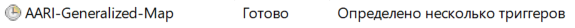
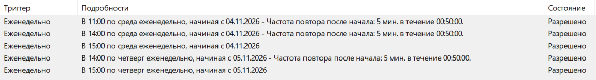

# 🧊 AARI-Generalized-Map — автоматизация «Обобщёнки»


> Автоматизация распространения готовых результатов общей обзорной ледовой карты Арктики ААНИИ: проверка файлов, копирование продуктов на сетевые ресурсы, подготовка почтовых вложений и еженедельный отчёт.
>
> **Важно:** объединение слоёв и подготовка итоговой карты в QGIS по-прежнему выполняются экспертом вручную. По умолчанию приложение работает в безопасном режиме `dry-run`.

---

<a id="russian"></a>

## 🇷🇺 Русский

## 🚦 Состояние проекта

| Компонент | Состояние |
|---|---|
| 🧪 Unit-тесты и CI                                 | Последний зафиксированный прогон: 41 тест, `OK`; GitHub Actions запускается при изменениях |
| 🗂️ Проверка имён и комплектности                   | Автоматические проверки и `dry-run` проходят без ошибок по последним предоставленным журналам |
| ✉️ Тест SMTP                                       | Отдельный тест из шести сообщений прошёл; рабочие адресаты изолированы от тестового списка |
| 📋 `STATUS.txt` и `aari_generalized_map.log`      | Краткий статус и подробный журнал формируются по этапам выпуска |
| 🕒 Планировщик Windows                              | На целевом ПК задача зарегистрирована в рабочем режиме `--execute` 29.10.2026; пять триггеров включены |
| ⚠️ Первый рабочий цикл                              | Ожидается 04.11.2026–05.11.2026; фактическое выполнение копирования и публикации ещё предстоит подтвердить |

## ✅ Что делает программа

| Этап                         | Назначение                                                                                                                                                            |
| ---------------------------- | --------------------------------------------------------------------------------------------------------------------------------------------------------------------- |
| 🔎 Проверка исходников       | Проверяет ожидаемые имена файлов, наличие обязательных компонентов shapefile `.shp`, `.shx`, `.dbf`, `.prj` и подозрительные размеры относительно эталонных значений. |
| 🗺️ Распространение карт      | Формирует задания копирования общей карты, региональных продуктов, SIGRID и LVP в согласованные сетевые каталоги.                                                     |
| ✉️ Почтовая рассылка         | Готовит пять писем по шаблонам `.eml` с датированными темами и ожидаемыми вложениями. Outlook и Thunderbird для отправки не запускаются.                              |
| 🌐 Публикация сайта          | В четверг обрабатывает каталог `website` предыдущего выпуска — с задержкой в одну неделю.                                                                             |
| 📅 Подготовка нового выпуска | Этап отчёта формирует план каталога следующей среды с папками `LVP`, `PIC`, `SHP`, `old_shore`, `sigrid`, `website`.                                                  |
| 📊 Отчётность                | В корневом каталоге источников сохраняет короткий `STATUS.txt` и подробный `aari_generalized_map.log`.                                                                |

Программа **не объединяет и не исправляет геоданные**: подготовка общей обзорной карты в QGIS остаётся ручной операцией.

## 🗓️ График выпуска

Папка выпуска создаётся на среду, а дата карты в именах файлов обычно относится ко вторнику. В темах писем период указывается в формате, например, `18-20 октября 2026 года`.

| День и время                          | Этап        | Что запланировано                                                                                                        |
| ------------------------------------- | ----------- | ------------------------------------------------------------------------------------------------------------------------ |
| Среда, 11:00–11:50 — каждые 5 минут   | `oldshore`  | Проверка и размещение SHP старого берега до 12:00                                                                        |
| Среда, 14:00–14:50 — каждые 5 минут   | `wednesday`       | Основные копии и повторная проверка `old_shore`; продуктовые письма отправляются только при запуске в 14:50          |
| Среда, 15:00                          | `report`          | Еженедельный статусный отчёт и подготовка папки следующего выпуска                                                   |
| Четверг, 14:00–14:50 — каждые 5 минут | `thursday`        | LVP и публикация материалов сайта за предыдущую неделю                                                               |
| Четверг, 15:00                        | `thursday-report` | Дополнительный отчёт по статусу после четверговых проверок; получатели те же, что у среды                             |

✅ По состоянию на 29.10.2026 задача `AARI-Generalized-Map` зарегистрирована на целевом ПК; скриншоты ниже показывают её состояние и пять включённых триггеров. Это подтверждает регистрацию, но не гарантирует, что будущие запуски успешно выполнят копирование и рассылку.

## 🛡️ Режимы запуска и безопасность

Без аргумента `--execute` программа работает в режиме `dry-run`: проверяет исходники и показывает план копирования и рассылки, но **не копирует продуктовые файлы и не отправляет письма**. Служебные файлы `STATUS.txt` и `aari_generalized_map.log` при этом обновляются в настроенном исходном каталоге.

| Команда / параметр | Поведение |
|---|---|
| `--stage validate` | Проверка комплекта выпуска; без копирования |
| `--stage oldshore` | Проверка и обработка SHP старого берега |
| `--stage wednesday` | Основные копии и пять продуктовых писем по расписанию среды |
| `--stage thursday` | LVP и публикация сайта за предыдущую неделю |
| `--stage report` | Недельный отчёт и создание/дополнение папки следующего выпуска |
| `--stage thursday-report` | Дополнительный отчёт за четверг без повторного создания папки |
| `--stage mail-test` | Изолированная подготовка пяти продуктовых писем и тестового отчёта |
| `--send-test-email` | Только вместе с `--stage mail-test`: фактически отправить шесть тестовых писем |
| `--stage auto` | Выбрать этап по текущему дню недели и времени |
| `--execute` | **Разрешает реальные копирования, рабочую отправку, публикацию и создание папок** |
| `--resend-changed-email` | Разрешает повторно отправить письмо при изменившихся вложениях; использовать только после проверки |

### ⛔ Важное предупреждение о Планировщике

Установщик `install_task.ps1` по умолчанию создаёт задачу в режиме `dry-run`. На целевом ПК 29.10.2026 установщик был повторно запущен с `-EnableLiveMode`; задача зарегистрирована с аргументами `--stage auto --execute`. Это **не только режим тестовой почты**: рабочий режим разрешает реальные копирования, пять продуктовых писем в среду в 14:50, публикацию материалов сайта и LVP в четверг, оба отчёта и создание/дополнение папки следующего выпуска.

Если нужно вернуть безопасный режим, из папки проекта выполните `.\install_task.ps1` **без** `-EnableLiveMode`: тот же объект задачи будет перерегистрирован без `--execute`. Не создавайте отдельную задачу с другим именем — у автоматизации один объект задачи и один BAT-файл.

### Проверка регистрации в PowerShell

Эти команды только читают состояние задачи и не запускают рабочие операции:

```powershell
$taskName = 'AARI-Generalized-Map'
$task = Get-ScheduledTask -TaskName $taskName

$task | Select-Object TaskName, State
$task.Actions | Format-List Execute, Arguments, WorkingDirectory
$task.Triggers | Format-List StartBoundary, Enabled, DaysOfWeek, Repetition
Get-ScheduledTaskInfo -TaskName $taskName |
    Format-List LastRunTime, LastTaskResult, NextRunTime
```

`LastTaskResult = 0` указывает на успешное завершение последнего запуска. До первого рабочего цикла это не подтверждает, что реальные копирования и письма уже выполнены.

## 🧰 Технологии

| Компонент              | Назначение                                               |
| ---------------------- | -------------------------------------------------------- |
| Python 3.10+           | Проверки, планирование операций и сетевое копирование    |
| `python-dotenv`        | Загрузка локальной конфигурации из `.env`                |
| `unittest`             | Автоматические проверки логики без реального копирования |
| `email` / `smtplib`    | Формирование и отправка почты из Python                  |
| Windows Task Scheduler | Планируемый запуск по временным окнам                    |

## 🚀 Установка и настройка окружения

Откройте PowerShell-терминал VS Code и выполните команды из папки проекта:

```powershell
cd E:\Programming_Work\VScode_Work\AARI-Generalized-Map
git pull

if (-not (Test-Path ".venv\Scripts\python.exe")) {
    py -m venv .venv
}
.\.venv\Scripts\python.exe -m pip install -r requirements.txt

if (-not (Test-Path ".env")) {
    Copy-Item .env.example .env
}
notepad .env
```

Если виртуальное окружение уже создано, повторно создавать его не требуется. Команда копирования `.env.example` не перезаписывает существующий `.env`.

🔐 **Не добавляйте рабочий файл `.env`, пароли, токены или другие учётные данные в Git.** Не публикуйте и не присылайте пароль SMTP. Настоящие значения хранятся только в локальном `.env`.

## ⚙️ Основные переменные `.env`

| Переменная                                   | Назначение                                                                            |
| -------------------------------------------- | ------------------------------------------------------------------------------------- |
| `AARI_SOURCE_ROOT`                           | Корневой каталог выпусков; по умолчанию `\\10.31.34.60\Tiris\МОРЕ\ОБОБЩЕНКА_ОТПРАВКА` |
| `AARI_MORE_ROOT`                             | Сетевой каталог `МОРЕ` для общей BMP и региональных PNG                               |
| `AARI_ICE_CHARTS_ROOT`                       | Корень каталога `Ice_charts`                                                          |
| `AARI_MORSPASS_ROOT`, `AARI_SOVBEZ_ROOT`     | Каталоги распространения morspass и sovbez                                            |
| `AARI_ICECHARTS_V_ROOT`                      | UNC-путь, соответствующий диску `V:\IceCharts`                                        |
| `AARI_LVP_WAVE_ROOT`                         | UNC-путь, соответствующий диску `Z:\LVP_WAVE`                                         |
| `AARI_WEBSITE_ROOT`                          | Каталог сайта `\\data.aari.ru\d0015\arctic`                                           |
| `AARI_SMTP_SERVER`, `AARI_SMTP_PORT`, `AARI_SMTP_SECURITY` | SMTP-сервер, порт и защита; для общего ящика — `zmail.aari.ru`, `25`, `auto` |
| `AARI_SMTP_AUTH_MODE`                      | `auto`: без пароля пропускает SMTP AUTH, с паролем авторизуется; `required`/`none` принудительные режимы |
| `AARI_SMTP_CA_FILE`                          | Необязательный путь к доверенному CA-сертификату/цепочке PEM для проверки TLS         |
| `AARI_SMTP_USERNAME`                         | SMTP-логин; для общего ящика `sever@aari.ru`                                          |
| `AARI_EMAIL_ADDRESS`                         | Адрес отправителя в заголовке и SMTP-конверте                                        |
| `AARI_EMAIL_NAME`                            | Отображаемое имя отправителя, необязательно                                           |
| `AARI_MAIL_PASSWORD`                         | Пароль общего ящика; старый ключ `AARI_EMAIL_PASSWORD` поддерживается                |
| `AARI_REPORT_RECIPIENTS`                     | Получатели еженедельного отчёта; адреса можно разделять запятой или точкой с запятой  |
| `AARI_SIZE_MIN_RATIO`, `AARI_SIZE_MAX_RATIO` | Границы проверки размера файлов; по умолчанию `0.35` и `2.5`                          |
| `AARI_LOG_LEVEL`                             | Уровень журнала; по умолчанию `INFO`                                                  |

Перед отправкой проверьте `AARI_EMAIL_ADDRESS`, `AARI_REPORT_RECIPIENTS` и адресатов во всех шаблонах `email_templates`. Не включайте рабочую отправку только ради проверки конфигурации — для этого предусмотрен `dry-run`.

### Правила редактирования почтовых шаблонов

Для автоматической отправки используются только пять файлов `.eml` в `email_templates`. Коллеги могут менять текст тела письма и заголовки `To`, `Cc`, `Bcc`, `Reply-To`. Сохраняйте имена файлов и корректный формат EML. Имена вложений и их количество задаются кодом; вложения из EML-шаблонов не используются.

Поле `From` в старом EML — исторические метаданные и не задаёт отправителя автоматизации. Фактический отправитель берётся из `AARI_EMAIL_ADDRESS`, SMTP-логин — из `AARI_SMTP_USERNAME`, пароль — из `AARI_MAIL_PASSWORD` (либо старого `AARI_EMAIL_PASSWORD`). Для рабочего ящика укажите `sever@aari.ru` в обоих полях адреса и логина. `AARI_EMAIL_NAME` задаёт отображаемое имя отправителя. Тема письма создаётся программой с актуальным периодом карты, поэтому изменение `Subject` в шаблоне не изменит тему рабочего письма. После любых правок сначала выполните `--stage mail-test` без `--send-test-email`, проверьте журнал и только затем согласуйте тестовую отправку на тестовый список.

Для общего ящика ЦЛГМИ используется `zmail.aari.ru:25` с `AARI_SMTP_SECURITY=auto`: программа использует STARTTLS, если сервер его предлагает. `AARI_SMTP_AUTH_MODE=auto` пропускает SMTP AUTH при пустом пароле и включает `login` только если пароль задан. Если сервер не предлагает STARTTLS, в `security=auto` можно продолжить без авторизации; в таком случае письмо передаётся без TLS, поэтому этот режим уместен только если такая схема согласована для внутренней сети. Разрешение на отправку без авторизации всё равно определяет почтовый сервер. Если сервер вернёт отказ relay, проверьте с ИТ, разрешён ли relay для рабочего ПК/IP или требуется логин. Режим `required` требует SMTP AUTH, `none` отключает её. Для порта `465` `security=auto` выбирает `SMTP_SSL`. Без `AARI_SMTP_CA_FILE` TLS шифрует соединение, но сертификат сервера не проверяется; задайте путь к доверенному CA-сертификату/цепочке PEM, если он доступен.

Если позднее потребуется проверка подлинности сервера, задайте в локальном `.env` путь к доверенному CA-сертификату/цепочке PEM: `AARI_SMTP_CA_FILE=C:/certificates/aari-mail-ca.pem`. В этом режиме сертификат проверяется; без корректного доверенного CA сервер с самоподписанной цепочкой будет отклонён. Не используйте случайный сертификат, снятый с сервера, как доверенный корневой.

## ▶️ Проверка и тестирование

### 1. Запустить unit-тесты

```powershell
.\.venv\Scripts\python.exe -m unittest discover -s tests -v
```

Тесты не обращаются к рабочим сетевым каталогам и не отправляют почту. Все тесты должны завершиться с `OK`.

### 2. Проверить комплект выпуска

```powershell
.\.venv\Scripts\python.exe .\main.py --stage validate --date 2026-10-21
```

Дата `2026-10-21` приведена как пример папки выпуска. При проверке другого выпуска замените её датой соответствующей папки в `ОБОБЩЕНКА_ОТПРАВКА`.

### 3. Просмотреть план среды и писем

```powershell
.\.venv\Scripts\python.exe .\main.py --stage wednesday --date 2026-10-21
```

### 4. Просмотреть четверговые копии и публикацию сайта

```powershell
.\.venv\Scripts\python.exe .\main.py --stage thursday --date 2026-10-22
```

### 5. Просмотреть еженедельный отчёт

```powershell
.\.venv\Scripts\python.exe .\main.py --stage report --date 2026-10-21
```

### 6. Проверить готовность шести тестовых писем (без SMTP)

Укажите дату существующей папки выпуска за среду. Команда проверит пять продуктовых шаблонов, вложения и структуру еженедельного отчёта. Это не отправляет письма.

```powershell
.\.venv\Scripts\python.exe .\main.py --stage mail-test --date 2026-10-21
```

### 7. Отправить тестовые письма

После успешного предварительного просмотра и проверки SMTP-параметров в локальном `.env` выполните команду:

```powershell
.\.venv\Scripts\python.exe .\main.py --stage mail-test --date 2026-10-21 --send-test-email
```

Будут отправлены **шесть отдельных тестовых писем**: пять продуктовых сообщений с реальными вложениями выбранного выпуска и одно тестовое письмо еженедельного отчёта. Все шесть направляются только на фиксированный тестовый список: `vvbusev@aari.ru`, `sanovikov@aari.ru` и `belgesova@aari.ru`. В темах стоит префикс `[TEST]`, а в теле — явная пометка теста. Адресаты из рабочих шаблонов и `AARI_REPORT_RECIPIENTS` не получат эти тестовые письма.

Режим `mail-test` требует явный `--date` папки выпуска за среду. Он не поддерживает `--execute`, не копирует продуктовые файлы, не создаёт папку следующего выпуска и не изменяет `STATUS.txt`; результаты пишутся в подробный журнал. Если SMTP не подтвердит результат одного из сообщений, отправка следующих остановится. В таком случае проверьте ящики перед повтором: сообщение могло дойти, даже если подтверждение потерялось.

Команды выше работают без `--execute`: это безопасные проверки плана. При их выполнении не должны копироваться продуктовые файлы, отправляться письма или создаваться папка следующего выпуска. Исключение — явно указанная выше команда с `--send-test-email`, которая отправляет тестовые сообщения только на разрешённые тестовые адреса.

## 📁 Структура исходного каталога

Пример одного выпуска:

```text
ОБОБЩЕНКА_ОТПРАВКА\
└── 2026-10-21\
    ├── LVP\
    ├── PIC\
    ├── SHP\
    ├── old_shore\
    ├── sigrid\
    └── website\
```

Имена файлов проверяются относительно даты выпуска и шаблонов продукта. Для shapefile обязательны четыре компонента: `.shp`, `.shx`, `.dbf` и `.prj`. В комплекте SIGRID используются аналогичные наборы компонентов, а для публикации сайта обрабатываются файлы и архивы ожидаемой структуры.

## 📋 Статус и журналы

Оба служебных файла по умолчанию сохраняются непосредственно в `AARI_SOURCE_ROOT`.

| Файл / событие                                 | Содержание                                                                                                                       |
| ---------------------------------------------- | -------------------------------------------------------------------------------------------------------------------------------- |
| `STATUS.txt`                                   | Краткая сводка по этапам выпуска: направления, типы и количество файлов, состояние писем                                         |
| `aari_generalized_map.log`                     | Подробная история `INFO`, `WARNING` и `ERROR`; перед каждым новым запуском добавляется пустая строка для разделения сеансов |
| `DRY_RUN_COPY`, `DRY_RUN_FILE`                 | Планируемые группы копирования и отдельные файлы — без фактического копирования                                                  |
| `MAIL_PLAN`, `MAIL_ATTACHMENT`                 | План письма и перечень вложений — без отправки в `dry-run`                                                                       |
| `VALIDATION_ERROR`, `COPY_ERROR`, `MAIL_ERROR` | События, требующие проверки                                                                                                      |

При ошибке сначала сверяйте имя выпуска и фактический состав папок с сообщениями в журнале. Если файлов не хватает либо размер выглядит подозрительно, соответствующая операция блокируется. Исходные материалы не удаляются; целевые файлы при реальном запуске могут заменяться, если их содержимое отличается. Резервные копии при замене не создаются.

## 🖼️ Скриншоты

Скриншоты зафиксированы 29.10.2026 в Планировщике Windows. Они иллюстрируют состояние зарегистрированной задачи и все пять разрешённых триггеров. Первый запуск рабочего расписания ожидается в среду, 04.11.2026; снимки подтверждают конфигурацию, но не результат ещё не состоявшегося рабочего цикла.

**Состояние задачи:**



**Пять включённых триггеров:**



## 🔒 Важные соглашения

- Дата папки выпуска — среда; дата карты в именах продуктов — вторник.
- В среду при каждом запуске рабочего расписания необходимо учитывать контроль времени: `old_shore` должен быть размещён до 12:00, а остальные продукты — до 15:00.
- CLI без `--execute` работает в `dry-run`; зарегистрированная задача на целевом ПК отдельно настроена с `--execute`.
- Рабочий режим проверяет и распространяет файлы только при доступности сетевых ресурсов; после каждого запуска проверяйте `STATUS.txt`, `aari_generalized_map.log` и историю Планировщика.
- Для запуска под `InteractiveToken` пользователь должен быть авторизован в Windows; ПК должен быть включён, а учётная запись — иметь доступ к сетевым каталогам и SMTP.
- При переносе проекта перепроверьте UNC-пути и права учётной записи. Не полагайтесь только на сопоставленные буквы дисков.
- Для возврата к `dry-run` перерегистрируйте задачу командой `.\install_task.ps1` без `-EnableLiveMode`.

## 🇬🇧 English summary

Windows automation for distributing already-prepared AARI Arctic overview-chart products. It validates filenames, shapefile components and approximate sizes; prepares network-share copies; builds five template-based emails; handles previous-week website material and LVP on Thursday; and maintains status and detailed logs. QGIS compilation remains a manual expert task, and direct CLI calls default to dry-run. The isolated `mail-test` stage can preview or explicitly send six `[TEST]` messages to a fixed test allowlist only; it never uses production template recipients for test delivery and never copies product files. As of 29 October 2026, the Windows Task Scheduler task on the target workstation was registered in live mode with five enabled triggers; the first complete live weekly cycle is scheduled for 4–5 November 2026 and is not yet confirmed.

---

<a id="contacts"></a>

## 🏢 Контакты / Department contacts

| Русский                                                                  | English                                                                   |
| ------------------------------------------------------------------------ | ------------------------------------------------------------------------- |
| Центр Ледовой и Гидрометеорологической Информации (ЦЛГМИ), Центр «Север» | Center of Ice and Hydrometeorological Information (CIHMI), Center “Sever” |
| Арктический и антарктический научно-исследовательский институт           | Arctic and Antarctic Research Institute                                   |
| ФГБУ «ААНИИ», Санкт-Петербург                                            | FSBI “AARI”, St. Petersburg                                               |
| Почта: [sever@aari.ru](mailto:sever@aari.ru)                             | E-mail: [sever@aari.ru](mailto:sever@aari.ru)                             |
| Почта: [vvbusev@aari.ru](mailto:vvbusev@aari.ru)                         | E-mail: [vvbusev@aari.ru](mailto:vvbusev@aari.ru)                         |
|                                 |                                        |

---

<p align="center">
  
</p>

<p align="center">
  <sub>MIT License · © 2026 Vlad Busev</sub>
</p>
